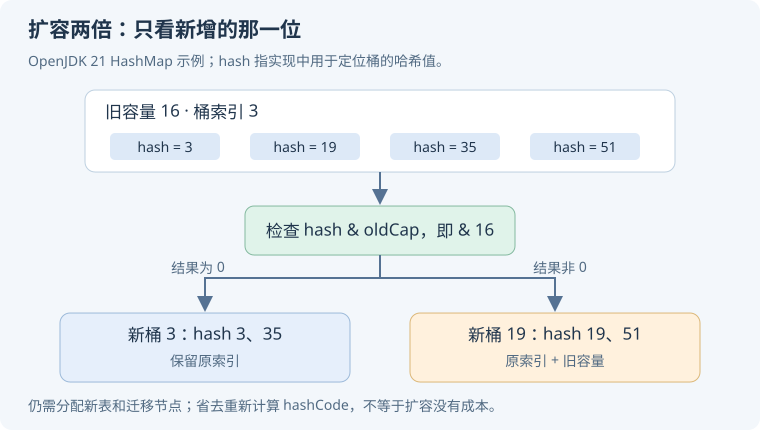

# 14 · 集合、类加载与运行时进阶

本章接续[语言基础](./language)，从“知道容器名称”走到“能根据访问模式、内存预算和并发规则选实现”。Java 实现细节以 **OpenJDK 21** 为示例；Android 应结合目标系统 libcore 与 ART 核对。

## 哈希与容器实现

### HashMap 为什么常用 2 的幂容量，扩容时怎样分配旧节点？ {#hashmap-resize}

OpenJDK 21 的 HashMap 用 `(n - 1) & hash` 定位桶，容量为 2 的幂时可以高效取低位。扩容为两倍后，一个旧桶中的节点，按 `hash & oldCap` 分到原索引或“原索引 + oldCap”，不必重新计算 key 的 hashCode。

<p class="diagram-scroll-hint">手机上可左右滑动查看完整图解。</p>

<div class="mobile-illustration">



</div>

```text
旧容量 16：索引依赖低 4 位
新容量 32：新增的第 5 位决定留在原桶，还是移动到原索引 + 16
```

**追问：扩容仍然有成本吗？** 有，需要新表、遍历和重连节点，并产生内存峰值。知道预期规模时可合理预分配，但构造参数与实际可容纳条目数还受负载因子影响。[实现：HashMap](https://github.com/openjdk/jdk21u/blob/master/src/java.base/share/classes/java/util/HashMap.java)。

### 链表树化为什么有容量条件，而不是碰到冲突就转红黑树？ {#treeify}

树节点比普通节点更复杂，小表中的长链可能只是容量太小导致的碰撞，先扩容可能就把节点分散。OpenJDK 21 使用树化、退化和最小表容量等不同条件，在查找成本与空间成本之间取舍。

| OpenJDK 21 常量 | 数值 | 含义 |
| --- | --- | --- |
| TREEIFY_THRESHOLD | 8 | 链表树化检查相关阈值，具体触发取决于插入路径与计数方式 |
| UNTREEIFY_THRESHOLD | 6 | 扩容拆分等路径中退化为普通桶的相关阈值 |
| MIN_TREEIFY_CAPACITY | 64 | 表较小时优先扩容，而不是直接树化 |

在普通 `putVal` 的链表追加路径中，`binCount` 的计数方式会使“已有 8 个节点再追加”触发相应树化检查，因此不能把常量 8 直接翻译成“第 8 次 put 必定变树”。相等 key 的值更新又不是新增节点。

不要只背“8、6、64”而忽略版本及调用路径：插入、扩容拆分和删除过程涉及的条件并不完全相同。树化改善特定冲突下的查找，并不让任意恶意 key 或昂贵 equals 都变得免费。

**实验：** 构造 hash 相同、equals 不同的 key，比较不同容量下插入和查找；观察节点类型变化，同时避免把单次运行当基准。[实现：treeifyBin](https://github.com/openjdk/jdk21u/blob/master/src/java.base/share/classes/java/util/HashMap.java)。

### ConcurrentHashMap 为什么不能只理解成“分段锁”？ {#concurrent-map}

“Segment 分段锁”主要对应旧实现。现代 OpenJDK ConcurrentHashMap 的更新结合 CAS、桶级协调和扩容协作等机制；读取通常无需获取同一把全局互斥锁，但不能据此声称每个方法在所有情况下都无等待。

`computeIfAbsent` 等原子复合操作比手写“先查再放”更准确。计算函数应短小，避免阻塞 I/O、递归更新或把跨多个 key 的业务事务塞进去；Map 的单次原子更新不等于多个对象的一致提交。[官方：ConcurrentHashMap](https://docs.oracle.com/en/java/javase/21/docs/api/java.base/java/util/concurrent/ConcurrentHashMap.html)。

### ArrayList 随机访问快，为什么头部删除慢？ {#arraylist}

数组支持按索引直接访问；头部或中间删除通常要移动后续元素，因此成本与移动数量相关。扩容也需复制，连续尾插可以具有摊还 O(1) 成本，但某一次尾插仍可能较慢。

“ArrayList 永远扩成 1.5 倍”属于具体实现描述，不是 List 接口契约。频繁在前部插删时先看是否能换访问模式，例如用队列或批量处理；不要只凭链表插入 O(1) 就认为 LinkedList 一定更快。[官方：ArrayList](https://docs.oracle.com/en/java/javase/21/docs/api/java.base/java/util/ArrayList.html)。

### 实现栈和队列，为什么常优先考虑 ArrayDeque？ {#deque}

ArrayDeque 用可增长数组组织双端操作，避免每个元素都分配链表节点，常有较好的内存局部性；它不接受 null，常规端点操作具有摊还常数时间特点。

LinkedList 若已持有目标节点，链接修改可以很快，但按索引找到节点仍需遍历，还多出节点对象与指针。真正选择取决于访问模式、元素规模和并发需求；这两者都不是默认线程安全队列。[官方：ArrayDeque](https://docs.oracle.com/en/java/javase/21/docs/api/java.base/java/util/ArrayDeque.html)。

### Android 的 SparseArray、ArrayMap 为什么可能更省内存？ {#compact-containers}

`SparseArray` 用整型 key 与对象值的数组结构避免 `Integer` 装箱和常规哈希节点；`ArrayMap` 也使用较紧凑的数组组织。它们以部分查找和插删成本换取内存优势，不是所有规模下都快于 HashMap。

| 访问特点 | 可以优先评估 | 需要测什么 |
| --- | --- | --- |
| 小规模 int → 对象映射 | SparseArray | 查找频率、删除后整理成本 |
| 小规模通用映射 | ArrayMap | 插入移动、碰撞与遍历成本 |
| 大规模频繁随机更新 | HashMap 等 | 容量、分配、负载与延迟 |

不要仅因为项目是 Android 就全量替换容器。[官方：SparseArray](https://developer.android.com/reference/android/util/SparseArray)、[ArrayMap](https://developer.android.com/reference/android/util/ArrayMap)。

## 迭代、一致性与引用

### fail-fast 能保证发现所有并发修改吗？ {#fail-fast}

不能。部分迭代器用修改计数检测结构变化并抛出 ConcurrentModificationException，但这是一种尽力检测机制，不是同步协议或正确性保证。单线程里绕过迭代器直接结构修改，也可能触发它。

迭代期间删除要遵守迭代器支持的方式，或先收集待删项再处理。并发场景则选合适的并发容器、快照或锁。**没有抛异常，不能证明程序没有数据竞争。**[官方：ArrayList 迭代规则](https://docs.oracle.com/en/java/javase/21/docs/api/java.base/java/util/ArrayList.html)。

### CopyOnWriteArrayList 为什么适合读多写少的监听器？ {#copy-on-write}

更新时复制底层数组，再发布新数组；迭代器读取创建时的快照，因此不会实时看到后来的修改。代价是每次更新的复制、临时内存和旧快照继续持有元素。

监听器少、广播频繁、注册变化少时值得评估；高频更新或大集合通常不合适。移除监听器后，已经取得快照的一次分发仍可能调用它，因此回调也应检查必要的有效性。[官方：CopyOnWriteArrayList](https://docs.oracle.com/en/java/javase/21/docs/api/java.base/java/util/concurrent/CopyOnWriteArrayList.html)。

### WeakHashMap 能自动解决监听器或页面泄漏吗？ {#weak-map}

WeakHashMap 弱持有 key，但 value 仍需谨慎设计。若 value 直接或间接强持有 key，就可能让 key 继续可达；GC 触发和条目清理时机也不能作为业务完成信号。

例如 `Map<Activity, Callback>` 中的 Callback 捕获 Activity，可能抵消预期。监听器通常应显式注销，资源应按生命周期关闭。弱引用表达“不拥有”，不表达“任务已结束”。[官方：WeakHashMap](https://docs.oracle.com/en/java/javase/21/docs/api/java.base/java/util/WeakHashMap.html)。

### ReferenceQueue 能告诉我们什么，能代替手动关闭资源吗？ {#reference-queue}

引用对象在特定条件满足后可进入关联 ReferenceQueue，工具可用它观测引用处理并清理辅助结构。具体入队条件取决于引用类型，不能一概说“入队就证明整个页面所有资源都已释放”。

原生资源、文件句柄和订阅应通过明确所有权及时释放，不能等待不可预测的 GC。分析泄漏时，引用队列只是证据的一部分，还要检查可达路径与业务寿命。[官方：ReferenceQueue](https://docs.oracle.com/en/java/javase/21/docs/api/java.base/java/lang/ref/ReferenceQueue.html)。

## 类加载与内存模型

### 类加载、链接和初始化有什么区别，Android 动态加载要注意什么？ {#class-loading}

加载得到类的表示；链接涉及验证、准备和解析等职责；初始化执行相应静态初始化逻辑。相同二进制类名由不同定义加载器加载，可能是不同类型，因此“名字相同”不保证强转成功。

父委派是常见的加载组织方式，不应理解成所有加载器都必须使用同一份固定代码。Android 的 DEX 加载、代码来源、权限、系统 API 限制和发布规则还有自己的边界。插件化不能被概括成“下载一个 dex，反射调一下”。[规范：JVM 加载与链接](https://docs.oracle.com/javase/specs/jvms/se21/html/jvms-5.html)。

### 为什么不能把 HotSpot 的 GC 参数直接用于 Android？ {#art-vs-hotspot}

语言语义相近，不等于运行时实现相同。ART 的 DEX 执行、编译策略、分配和 GC 行为随系统版本演进；桌面 HotSpot 的 G1、ZGC 参数及诊断结论不能直接移植成 Android 操作指南。

Android 应从分配速率、存活对象、GC 时段、native/图形内存与进程限制入手。Java 堆下降而 PSS 不立刻等比例下降，也可能涉及内存页、分配器和共享映射，不能单凭一条曲线断言泄漏。[官方：ART GC 诊断](https://source.android.com/docs/core/runtime/gc-debug)。

## 源码阅读与实验

沿 `put → resize/treeifyBin` 追一次 HashMap 插入；用慢迭代器观察 CopyOnWrite 快照；再构造 value 回指 key 的 WeakHashMap，解释为什么改成弱 key 仍不能替代所有权设计。回答时同时报告代码版本与实验条件。
