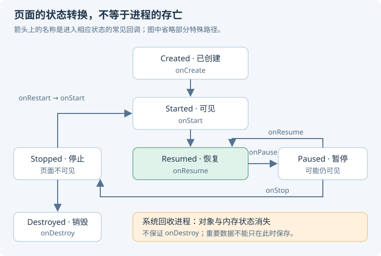

# 02 · 组件、生命周期与后台任务

这一章最关键的区别是：**组件生命周期、View 生命周期、进程生命周期和任务生命周期并不相同。** 把它们混成一个概念，会同时造成状态丢失、泄漏和后台任务中断。

## 页面与状态

### Activity 的生命周期怎么回答，`onPause` 就是不可见吗？ {#activity-lifecycle}

首次创建通常经历 `onCreate → onStart → onResume`；失去前台交互可能进入 `onPause`，完全不可见后进入 `onStop`；从停止状态回来通常经过 `onRestart → onStart → onResume`。

<p class="diagram-scroll-hint">手机上可左右滑动查看完整图解。</p>

<div class="mobile-illustration">



</div>

<KnowledgeFlow title="Activity 的常见前后台转换" :steps="[
  { title: '创建', detail: 'onCreate：初始化页面与恢复状态' },
  { title: '可见', detail: 'onStart：页面进入可见阶段' },
  { title: '交互', detail: 'onResume：处于恢复状态' },
  { title: '离开', detail: 'onPause；完全不可见时 onStop' }
]" caption="从 onStop 返回并不是重新执行 onCreate；只有重建实例时才再次创建。" />

**`onPause` 不等于不可见，`onStop` 不等于进程死亡。** 多窗口、透明界面等都会影响可见性与恢复状态。不要在 `onPause` 做重型持久化，也不要假设进程退出前一定收到 `onDestroy`。[官方：Activity 生命周期](https://developer.android.com/guide/components/activities/activity-lifecycle)。

### 配置变更和进程死亡，数据分别怎么恢复？ {#state-restoration}

**先按数据寿命分三层，再选工具。** ViewModel 存内存状态，saved state 保存轻量恢复线索，数据库或文件持久化长期数据。

| 机制 | 配置变更重建 | 系统回收进程后恢复 | 用户结束页面后长期保留 |
| --- | --- | --- | --- |
| ViewModel | 通常可保留同一作用域实例 | 原实例消失 | 否 |
| SavedStateHandle / saved instance state | 可恢复受支持状态 | 在系统保存并恢复任务的条件下可恢复 | 不保证 |
| Room / 文件 / 持久配置 | 可重读 | 可重读 | 按业务与清理策略保留 |

例如商品页保存 `productId`、筛选条件和滚动位置，重建后重读详情。大图片和整份列表不要塞进 Bundle，避免序列化成本与 Binder 事务压力。

**追问：`force-stop` 能测试所有恢复路径吗？** 不能。强行停止、移除任务、配置变更、后台进程被系统回收是不同场景；“不保留活动”也不能完整模拟进程死亡。测试要明确触发条件。[官方：保存 UI 状态](https://developer.android.com/topic/libraries/architecture/saving-states)。

### Fragment 为什么有两个 Lifecycle？ {#fragment-view}

Fragment 实例可以继续留在返回栈中，而它的 View 已被销毁。因此，**Fragment 对象的寿命可能长于当前 View 树**。观察 UI 数据应绑定 `viewLifecycleOwner`；ViewBinding 应在 `onDestroyView` 清空。

```kotlin
private var _binding: DetailBinding? = null

override fun onDestroyView() {
    super.onDestroyView()
    _binding = null
}
```

**追问：协程收集该放哪个 scope？** 更新 Fragment View 的收集放在 `viewLifecycleOwner.lifecycleScope`，配合 `repeatOnLifecycle`；用 Fragment 自身 scope 可能在 View 已销毁后继续访问旧界面。[官方：Fragment 生命周期](https://developer.android.com/guide/fragments/lifecycle)。

### 四种 launchMode 和返回栈有什么关系？ {#launch-mode}

| 模式 | 常见行为 | 需要确认的边界 |
| --- | --- | --- |
| `standard` | 每次创建新实例 | 默认模式 |
| `singleTop` | 目标在栈顶时可复用，调用 `onNewIntent` | 不在栈顶仍可新建 |
| `singleTask` | 按任务规则寻找可复用实例，可能清除其上的 Activity | 结合 affinity、flags 和任务状态分析 |
| `singleInstance` | 该 Activity 独占自己的任务 | 其他 Activity 进入别的任务 |

不要把 `singleTask` 简化为“全设备只有一个实例”。任务、文档模式和多窗口会改变讨论前提；还有 `singleInstancePerTask` 等模式，需按目标版本查证。

**追问：复用实例后参数为什么没更新？** 新参数在 `onNewIntent` 中处理；如果业务依赖 `getIntent()`，需要适当地更新当前 Intent。导航还要处理重复点击和深链验证。[官方：任务与返回栈](https://developer.android.com/guide/components/activities/tasks-and-back-stack)。

## 四大组件与后台工作

### Service 是子线程吗，前台服务能永久保活吗？ {#service}

**Service 是组件，不是线程。** 默认回调运行在进程主线程，耗时 I/O 仍要交给合适的执行器或协程。启动式服务与绑定式服务是不同的使用和寿命管理方式。

前台服务用于用户能感知的持续工作，并要求相应通知、声明和权限；不能保证进程永不被杀。后台启动限制、前台服务类型、超时规则和用户停止行为都可能限制它。

**追问：为什么“每分钟拉起一次服务”不可靠？** 系统会综合电量、后台状态和平台规则调度；设计应采用可恢复的任务，而不是依赖进程永远活着。[官方：前台服务](https://developer.android.com/develop/background-work/services/fgs)。

### WorkManager、协程、前台服务、AlarmManager 怎么选？ {#background-choice}

| 需求 | 优先考虑 | 原因与边界 |
| --- | --- | --- |
| 页面关闭即可放弃的加载 | 生命周期关联协程 | 随页面或 ViewModel 作用域取消 |
| 需要持久调度的同步、日志上报 | WorkManager | 支持约束、重试、任务链；不保证精确时间 |
| 用户感知的持续播放、导航等 | 合适的前台服务方案 | 遵守类型、权限与启动规则 |
| 有明确用户场景的定时提醒 | AlarmManager | 精确闹钟还受授权与平台规则约束 |

WorkManager 能在满足条件后重新调度工作，不代表执行代码在进程死亡时继续原地运行；需要业务幂等、持久化进度和可重试设计。用户强行停止应用后，也不能假设任务仍可立即运行。[官方：WorkManager](https://developer.android.com/develop/background-work/background-tasks/persistent/getting-started)。

### BroadcastReceiver 能执行长任务吗？ {#broadcast}

`onReceive` 应尽快返回。动态注册通常用于特定存活范围内的监听，静态注册受到隐式广播与后台限制；是否导出、发送方权限和目标版本同样重要。

`goAsync()` 允许在回调返回后短暂处理，并要求最终调用 `PendingResult.finish()`，**不等于无限后台执行许可**。需要持久工作时，把必要输入交给合适的任务调度方案。[官方：广播概览](https://developer.android.com/develop/background-work/background-tasks/broadcasts)。

**易错点：** 广播可来自不可信来源。检查 action 和参数，敏感接收器通过权限与导出策略限制访问；不要只因为“组件在本应用里”就认为安全。

### ContentProvider 为什么常用于跨进程数据共享？ {#provider}

Provider 通过 URI、数据操作接口及系统权限模型暴露数据，支持基于 Binder 的跨进程访问；它不是数据库的同义词，也能提供文件等数据。

客户端通常通过 `ContentResolver` 访问。并发请求可能从 Binder 线程进入，内部数据访问需要正确的线程与事务策略；大文件优先用文件描述符或流式接口，不要把内容塞进返回 Bundle。

**追问：FileProvider 有什么意义？** 以受控的 `content://` URI 和临时授权共享文件，避免直接暴露本地文件路径。Provider 也可能在 Application 的 `onCreate` 之前初始化，过重初始化会影响启动。[官方：Provider](https://developer.android.com/guide/topics/providers/content-provider-basics)。

## 生命周期中的工程边界

### Activity Context 与 Application Context 如何选择？ {#context}

Context 不只是“全局环境变量”，它关联资源、组件操作和配置。UI 通常需要合适的、带主题的 Activity Context；长寿命对象可以在合适场景使用 Application Context。

**不能用“全部换成 Application Context”解决一切。** 主题、窗口和当前配置可能不同；单例更不应保存 Activity、View 或短寿命回调。

如果 Repository 只是读取应用文件，Application Context 通常足够；如果要展示 Dialog，通常应由 UI 层基于当前界面环境执行。[官方：进程与线程](https://developer.android.com/guide/components/processes-and-threads)。

### 多进程应用里，单例和 SharedPreferences 还是同一份吗？ {#multiprocess}

每个进程有独立地址空间、静态变量和对象图，因此“单例”通常只在进程内单例。Application 初始化也要考虑当前进程，避免在辅助进程重复初始化全部 SDK。

跨进程共享要选择明确支持多进程一致性的机制，例如受控 Provider、Binder 服务、数据库的适用并发方案或专门的多进程存储实现；普通内存锁与普通 SharedPreferences 缓存不能当作跨进程同步协议。

**追问：切到多进程一定省内存吗？** 不一定。隔离崩溃和权限边界有价值，但有额外运行时、初始化、IPC 与一致性成本。[官方：进程与线程](https://developer.android.com/guide/components/processes-and-threads)。

## 面试前自测

画出“旋转屏幕 → 退到后台 → 系统回收进程 → 从任务返回”的过程，为每一步标注 Activity、ViewModel、数据库数据是否仍在。再说明一个下载任务为什么不能只活在 Activity scope 中。
