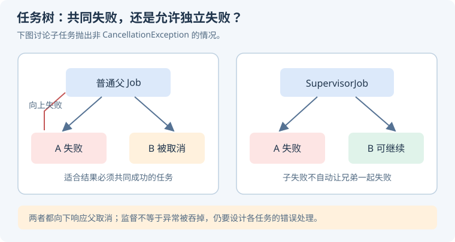

# 05 · 协程、Flow 与并发

协程把异步过程写成顺序代码，但不会替你决定线程、业务寿命和错误语义。回答时先说清楚：**在哪执行、由谁拥有、什么时候取消、失败影响谁**。

## 挂起与任务结构

### `suspend` 会自动切到后台线程吗？ {#suspend}

**不会。`suspend` 表示函数可以参与挂起调用，不承诺它一定挂起，更不承诺切线程。** 挂起时保存执行状态，在结果可用后恢复；如果函数里直接执行阻塞 I/O，仍会阻塞当前线程。

```kotlin
class FileRepository(private val io: CoroutineDispatcher) {
    suspend fun readText(file: File): String = withContext(io) {
        file.readText()
    }
}
```

这里通过注入 dispatcher 让阻塞文件操作离开主线程，也方便测试。已经提供非阻塞挂起 API 的库，不必为了形式在每层再套 `Dispatchers.IO`。[官方：调度器与上下文](https://kotlinlang.org/docs/coroutine-context-and-dispatchers.html)。

### `launch`、`async`、`withContext`、`runBlocking` 有何区别？ {#builders}

| API | 返回 / 行为 | 常见用途 |
| --- | --- | --- |
| `launch` | 返回 Job | 启动不直接返回计算值的子任务 |
| `async` | 返回 Deferred，`await` 获取结果 | 需要并发组合结果的任务 |
| `withContext` | 挂起直到块结束并返回值 | 切换上下文并等待结果 |
| `runBlocking` | 阻塞调用线程直到完成 | 适合特定同步入口；不用于主线程桥接业务 |

**`async` 不等于“异常只有 await 才会影响别人”。** 结构化并发中的子 `async` 失败通常仍会取消父任务；根协程或监督作用域的传播规则不同。[官方：协程异常](https://kotlinlang.org/docs/exception-handling.html)。

### 结构化并发到底“结构化”在哪里？ {#structured-concurrency}

任务通过 Job 建立父子关系：父任务等待孩子完成，父取消向下传播，普通子任务失败可能导致父与兄弟取消。任务的寿命因此可以沿作用域追踪，而不是散落在全局。

<KnowledgeFlow title="页面数据加载的责任链" :steps="[
  { title: '所有者', detail: '页面或 ViewModel 定义任务寿命' },
  { title: '父 Job', detail: '统一等待与取消子任务' },
  { title: '并发子任务', detail: '分别加载业务数据并遵守失败策略' },
  { title: '结束', detail: '全部完成，或失败 / 取消后清理资源' }
]" />

**追问：为什么不用 GlobalScope？** 它难以随业务所有者结束，也让异常与测试不易控制。确实需要应用级工作时，建立明确的应用级 scope 并管理它，而不是让每个函数自行脱离任务树。

### `coroutineScope` 和 `supervisorScope` 怎么选？ {#supervisor}

多个结果必须共同成功时，普通 `coroutineScope` 的共同失败语义更容易表达；可独立失败的模块可考虑 `supervisorScope`，但要分别处理错误。

<p class="diagram-scroll-hint">手机上可左右滑动查看完整图解。</p>

<div class="mobile-illustration">



</div>

**监督不等于吞掉异常。** `supervisorScope` 自身代码抛异常仍会使整个 scope 失败；子 `launch` 的未处理异常仍需处理，子 `async` 的失败要按设计 `await` 并消费。

例如商品详情与价格必须一起成功，可共同失败；旁边的推荐位失败，则可以降级。先定义业务关系，再选择作用域。[官方：supervisorScope](https://kotlinlang.org/api/kotlinx.coroutines/kotlinx-coroutines-core/kotlinx.coroutines/supervisor-scope.html)。

### 协程取消为什么需要配合？ {#cancellation}

取消通常通过 Job 状态和可取消挂起点协作完成。纯 CPU 循环可能一直不挂起，需要检查 `isActive`、调用 `ensureActive()` 或在合适位置 `yield()`。

```kotlin
suspend fun checksum(parts: List<ByteArray>): Long {
    var result = 0L
    for (part in parts) {
        currentCoroutineContext().ensureActive()
        result += part.sumOf { it.toLong() }
    }
    return result
}
```

这里只在块间检查；单块特别大时仍需细化检查粒度。清理放在 `finally`；确实需要挂起清理时，谨慎、短暂地使用 `NonCancellable`。[官方：ensureActive](https://kotlinlang.org/api/kotlinx.coroutines/kotlinx-coroutines-core/kotlinx.coroutines/ensure-active.html)。

**易错点：** 宽泛 `catch (Exception)` 和 `runCatching` 可能捕获取消异常；除非明确转换语义，应重新抛出 `CancellationException`。取消本地等待，也不保证服务器已经停止业务。

## Flow、状态与事件

### 冷 Flow、StateFlow、SharedFlow 有什么区别？ {#flow-types}

| 类型 | 启动与共享 | 新订阅者看到什么 | 适合表达 |
| --- | --- | --- | --- |
| 常见 `flow {}` 冷流 | 每次收集通常重新运行上游 | 本次收集产生的数据 | 按需执行的数据过程 |
| StateFlow | 热流，持有当前状态 | 立即获得当前值 | 页面当前 UI 状态 |
| SharedFlow | 热流，多订阅者共享 | 由 replay 等配置决定 | 广播式数据或信号 |

StateFlow 基于相等性合并更新，慢收集者可能跳过中间状态；SharedFlow 的缓冲、重放和溢出策略要显式设计。`stateIn/shareIn` 把冷流共享时，还要回答共享 scope 和启动策略。[官方：状态流与共享流](https://developer.android.com/kotlin/flow/stateflow-and-sharedflow)。

### StateFlow 可以保证“每个事件处理一次”吗？ {#stateflow-events}

**不能。StateFlow 描述最新状态，不提供完整事件日志。** 连续写入相等值可能被合并，慢订阅者也可能只看到较新的状态；SharedFlow 没有订阅者且不重放时，发射也可能无人接收。

对“订单已经支付”这样的关键业务事实，应持久化并通过 ID、确认机制和幂等处理管理；Snackbar 等短暂 UI 提示可根据需求选择状态或事件机制。不能仅靠换一种流实现跨进程死亡的 exactly-once。

```kotlin
private val _state = MutableStateFlow(UiState())
val state: StateFlow<UiState> = _state.asStateFlow()

fun select(id: Long) {
    _state.update { old -> old.copy(selectedId = id) }
}
```

`update` 的 lambda 可能重试，应避免在里面执行网络请求、埋点等副作用。[官方：StateFlow 语义](https://kotlinlang.org/api/kotlinx.coroutines/kotlinx-coroutines-core/kotlinx.coroutines.flow/-state-flow/)。

### `flowOn`、`catch`、`buffer`、`conflate` 和 `collectLatest` 怎么解释？ {#operators}

- [`flowOn`](https://kotlinlang.org/api/kotlinx.coroutines/kotlinx-coroutines-core/kotlinx.coroutines.flow/flow-on.html) 改变它上游的执行上下文，不会把它下方所有收集逻辑一起切走。
- [`catch`](https://kotlinlang.org/api/kotlinx.coroutines/kotlinx-coroutines-core/kotlinx.coroutines.flow/catch.html) 处理上游异常，不能自动捕获它之后的转换或最终 collect 中的异常。
- [`buffer`](https://kotlinlang.org/api/kotlinx.coroutines/kotlinx-coroutines-core/kotlinx.coroutines.flow/buffer.html) 通过缓冲解耦生产与消费，需考虑容量和溢出。
- [`conflate`](https://kotlinlang.org/api/kotlinx.coroutines/kotlinx-coroutines-core/kotlinx.coroutines.flow/conflate.html) 允许跳过尚未处理的旧值，适合“最新状态优先”。
- [`collectLatest`](https://kotlinlang.org/api/kotlinx.coroutines/kotlinx-coroutines-core/kotlinx.coroutines.flow/collect-latest.html) 在新值到来时取消上一次收集块，块内工作必须配合取消。

**追问：少处理旧值一定正确吗？** 不一定。渲染最新进度可以，记账或逐条可靠写入通常不能直接丢弃中间项。上面的操作符名称链接到相应官方 API。

### Android 界面为什么要按生命周期收集？ {#lifecycle-collection}

页面进入后台后仍持续收集，可能浪费资源或访问旧 View。Fragment 的 UI 收集通常绑定 View 生命周期，并在达到期望状态时启动：

```kotlin
viewLifecycleOwner.lifecycleScope.launch {
    viewLifecycleOwner.repeatOnLifecycle(Lifecycle.State.STARTED) {
        launch { viewModel.state.collect { render(it) } }
        launch { viewModel.badges.collect { renderBadges(it) } }
    }
}
```

分别用子 `launch` 收集永不结束的热流，避免第一条 collect 阻止第二条开始。离开 STARTED 会取消块内收集，回来重新启动；冷流因此可能重启上游。Compose Android UI 通常用 `collectAsStateWithLifecycle`。[官方：生命周期协程](https://developer.android.com/topic/libraries/architecture/coroutines)。

### 搜索框为什么常用 `debounce + distinctUntilChanged + flatMapLatest`？ {#search}

防抖减少快速输入的请求，去重避免相同查询重复执行，`flatMapLatest` 在新查询到来时取消旧的结果流。生产实现还需要处理空串、错误和过期结果。

```kotlin
// 省略类型与 import；这些操作符可能要求对应版本的 @OptIn。
val results = query
    .map { it.trim() }
    .debounce(300)
    .distinctUntilChanged()
    .flatMapLatest { keyword ->
        flow<SearchState> {
            if (keyword.isBlank()) {
                emit(SearchState.Empty)
            } else {
                emit(SearchState.Loading)
                emit(SearchState.Success(repository.search(keyword)))
            }
        }.catch { error ->
            if (error is CancellationException) throw error
            emit(SearchState.Error(error))
        }
    }
```

把单次查询错误处理放在内层，避免一次错误结束整个输入管线。若底层不能可靠取消或存在外部回调，还要使用查询版本号等方式拒绝过期结果；防抖延迟也意味着旧结果在新查询真正进入下游前仍可能返回。[官方：flatMapLatest](https://kotlinlang.org/api/kotlinx.coroutines/kotlinx-coroutines-core/kotlinx.coroutines.flow/flat-map-latest.html)。

## 面试前自测

写一个协程程序，让两个子任务分别失败，观察普通 scope 与 supervisor 的区别。再连续更新 StateFlow，刻意让收集端变慢，验证它为什么不是事件队列。

### 自测参考答案

下面的 JVM 示例依赖 `kotlinx-coroutines-core`，用于观察直接子任务的失败传播；`runBlocking` 只用于这个控制台入口，不放进 Android 主线程。

```kotlin
import kotlinx.coroutines.*

fun main() = runBlocking {
    try {
        coroutineScope {
            launch { delay(100); error("A failed") }
            launch {
                try {
                    delay(300)
                    error("B failed")
                } finally {
                    println("ordinary B cleanup")
                }
            }
        }
    } catch (e: IllegalStateException) {
        println("ordinary: ${e.message}")
    }

    val handler = CoroutineExceptionHandler { _, e ->
        println("supervised: ${e.message}")
    }
    supervisorScope {
        launch(handler) { delay(100); error("A failed") }
        launch(handler) { delay(300); error("B failed") }
    }
}
```

**预期：** 普通 scope 中 A 失败会取消 B，B 通常只执行清理而到不了自己的 `error`，异常由外层捕获。监督作用域中两个直接子任务独立失败，handler 分别记录异常。supervisor 不会自动吞异常；若作用域块本身抛异常，仍会取消其子任务。使用 `async` 时需观察 `await` 的异常，不能把 handler 当作统一接收器。[官方：异常传播与监督](https://kotlinlang.org/docs/exception-handling.html)。

**StateFlow 实验：** 在同一个 `runBlocking` 中执行以下片段，并补充 `import kotlinx.coroutines.flow.*`：

```kotlin
val state = MutableStateFlow(0)
val collector = launch(start = CoroutineStart.UNDISPATCHED) {
    state.collect { value ->
        println("received: $value")
        delay(100) // 模拟慢消费者
    }
}
repeat(5) { state.value = it + 1 }
delay(250)
collector.cancelAndJoin()
```

这个受控顺序下会先收到 0，随后收到最新的 5，中间 1～4 不必逐条送达；相等值的更新也会被抑制。StateFlow 表达当前状态，不能承担可靠事件队列。需要逐条处理时再明确缓冲、背压和确认机制，跨进程重启可靠性还需要持久化。[官方：StateFlow 合并语义](https://kotlinlang.org/api/kotlinx.coroutines/kotlinx-coroutines-core/kotlinx.coroutines.flow/-state-flow/)。
