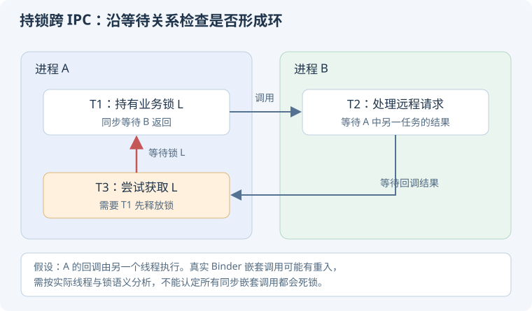

# 17 · Framework、启动与 Binder 深入

本章接续[系统机制基础](./framework)。源码入口以 **AOSP Android 16 初始发布标签 `android-16.0.0_r1`** 为阅读样本；平台实现会演进，图中用职责描述代替固定方法栈。

## 从系统到应用

### Zygote 的预加载与 fork 为什么有价值？是不是完全复制一份内存？ {#zygote}

Zygote 预先建立运行时与部分公共状态，应用进程可从相应 Zygote 路径派生。fork 结合写时复制，使部分未修改页可共享；不是立刻把每个内存页都物理复制一遍。

共享不意味着所有页面永久免费：后续写入会使相关页分离，应用自己的堆与资源也继续增长。USAP 等预建进程机制还会改变实际启动路径，不能把一次观测推广到所有配置。[官方：Zygote](https://source.android.com/docs/core/runtime/zygote)。

### `startActivity` 为什么不是直接 new 一个 Activity？ {#launch-transaction}

启动请求需要系统判断目标组件、权限、任务与进程状态；应用侧随后接收系统调度，在主线程完成相应创建、恢复和窗口工作。跨进程请求与应用内回调属于不同阶段。

<KnowledgeFlow title="启动请求与页面创建隔着系统调度" :steps="[
  { title: '调用方', detail: '发起 Intent，说明目标与启动语义' },
  { title: '系统协调', detail: '解析组件、任务栈、权限与进程' },
  { title: '应用接收事务', detail: '调度到应用主线程执行生命周期' },
  { title: '创建并显示', detail: '实例、Context、状态、窗口与首帧协作' }
]" />

手动 `Activity()` 不会自动接入系统生命周期与窗口管理。追源码时可从 ActivityThread 的事务与 launch 处理入口继续追 Instrumentation。[源码：ActivityThread](https://android.googlesource.com/platform/frameworks/base/+/android-16.0.0_r1/core/java/android/app/ActivityThread.java)。

### `attachBaseContext`、Provider 与 `Application.onCreate` 的顺序有什么用？ {#application-init}

应用对象需要先建立 Context 等环境；常规应用绑定流程还会安装相关 Provider，再执行 Application 的创建回调。不要把 `onCreate` 当成所有初始化中绝对最早的入口。

因此依赖 Provider 的自动初始化、SDK 或数据库可能提前出现在启动关键路径。组件也可能处在不同进程，每个进程要分别分析，不能把一次主进程日志当作全局顺序。[源码：handleBindApplication](https://android.googlesource.com/platform/frameworks/base/+/android-16.0.0_r1/core/java/android/app/ActivityThread.java)。

### ActivityThread 是新线程吗，system_server 和应用进程是什么关系？ {#process-roles}

ActivityThread 是应用主线程相关管理类，名字里有 Thread 不代表它就是一个 Thread 子类。system_server 承载多个系统服务，与普通应用进程隔离，通过 IPC 协作。

“AMS 的工作”和“应用主线程执行生命周期”不能混在同一条本地调用栈中；一次同步调用可能穿过 Binder 后，又通过应用消息或事务异步执行。定位时先画进程和线程边界。[官方：Android 架构](https://source.android.com/docs/core/architecture)。

### ServiceManager 与 `Context.getSystemService` 是同一个东西吗？ {#service-manager}

ServiceManager 参与 Binder 服务的注册与查找；应用侧系统服务 API 还可能经过 framework 的 manager 包装、缓存和上下文适配。拿到某个 Manager 对象，不代表每个方法都是一次新的远程查找。

也不能把 Android Service 组件和系统 Binder 服务都叫“同一种 Service”。前者有组件生命周期，后者是系统架构中的服务接口与实现。[源码：ServiceManager](https://android.googlesource.com/platform/frameworks/base/+/android-16.0.0_r1/core/java/android/os/ServiceManager.java)。

## Binder 并发、身份与失败

### Binder 为什么可能发生重入，持锁远程调用有什么危险？ {#binder-reentrancy}

同步 Binder 事务可形成嵌套调用；调用链经过其他进程后又回到原进程时，需考虑重入和并发访问。远程方法不是“像本地函数一样没有额外风险”。

若 A 持本地锁调用 B，而 B 又等待需要该锁的回调或其他资源，就可能形成死锁。设计窄接口、避免持业务锁跨 IPC，并把超时与可恢复失败纳入协议。[官方：Binder 线程模型](https://source.android.com/docs/core/architecture/ipc/binder-threading)。

<p class="diagram-scroll-hint">手机上可左右滑动查看完整图解。</p>

<div class="mobile-illustration">



</div>

### `getCallingUid` 与 `clearCallingIdentity` 为什么涉及安全边界？ {#calling-identity}

Binder 调用携带调用身份，服务端可以据此做授权。服务代表外部调用者继续访问其他能力时，应明确采用谁的身份；不能不加判断地把自己的权限借给任意调用者。

确需清除调用身份时，应把返回 token 保存并在 finally 恢复。清除身份不代替参数校验和授权，也不能在切换到异步任务后仍假设原调用现场自动保留。[官方：Binder 身份 API](https://developer.android.com/reference/android/os/Binder)。

### DeathRecipient 能保证知道某个请求到底有没有执行吗？ {#death-recipient}

死亡通知帮助感知远程 Binder 所在进程等相关死亡情况，并安排清理或重连；它不提供每个业务请求的精确提交状态。调用抛异常时，请求可能尚未执行，也可能已执行但响应丢失。

需要“不能重复执行”的业务，应使用业务请求 ID、持久化结果与查询确认。重连后应重新建立会话和订阅，不应直接重放所有旧请求。[官方：IBinder](https://developer.android.com/reference/android/os/IBinder)。

## 消息机制的源码追问

### Handler 的 Runnable、Callback 和 `handleMessage` 谁优先？ {#handler-dispatch}

在所选 AOSP 样本中，dispatchMessage 先检查消息携带的 Runnable callback；没有该 callback 时再交给 Handler.Callback，若未消费，才进入 Handler 自身的 handleMessage。

```text
Message.callback 存在 → 执行 Runnable
否则 Callback.handleMessage 返回 true → 结束
否则 → Handler.handleMessage
```

所以 `post { ... }` 不应被假设一定经过你覆写的 handleMessage。调试拦截点时先检查实际分发分支。[源码：Handler.dispatchMessage](https://android.googlesource.com/platform/frameworks/base/+/android-16.0.0_r1/core/java/android/os/Handler.java)。

### Message 对象池能省什么，发送后还能继续修改消息吗？ {#message-pool}

对象池减少部分 Message 分配与回收压力，但不能消除消息携带的 Runnable、Bundle 或业务对象的成本。消息入队后不应继续按“仍由发送方独占”来修改字段，处理和回收后也不能继续持有并重用其旧内容。

同一个 Message 重复发送或错误手动回收会破坏所有权约定。优化前先看分配证据，不能为了减少几个 Message 而构建更复杂、更容易出错的私有池。[源码：Message](https://android.googlesource.com/platform/frameworks/base/+/android-16.0.0_r1/core/java/android/os/Message.java)。

### IdleHandler 是不是“系统空闲时随便做长任务”的机会？ {#idle-handler}

IdleHandler 在消息队列达到相应空闲条件时得到回调，返回值决定是否继续保留。它仍运行在所属 Looper 线程，不能保证之后很长一段时间都没有输入或绘制到来。

长任务仍会阻塞后续消息，重复注册还可能延长对象寿命。适合短小、可控的空闲处理，而不是把整个启动初始化全部搬进去；必须测量它对下一次交互的影响。[官方：IdleHandler](https://developer.android.com/reference/android/os/MessageQueue.IdleHandler)。

### PendingIntent 为什么不是一份普通 Intent？身份匹配忽略什么？ {#pending-intent}

PendingIntent 是把某种操作能力交给其他执行方的 token，执行时涉及创建方身份与平台约束。其匹配规则由请求种类、requestCode 和 Intent 的相应身份字段等决定，不能只靠不同 extras 就假设获得不同 token。

要按用途声明可变性并限制可被修改的内容；更新、取消、一次性操作及深链参数都需明确。用户点击通知后出现旧参数时，先检查 token 匹配与更新策略。[官方：PendingIntent](https://developer.android.com/reference/android/app/PendingIntent)。

## 源码阅读路线

先画出调用方、system_server、应用 Binder 线程和主线程四条泳道，再追一条启动事务。不要把方法名串成背诵列表；为每一步标注线程、等待方式、身份和失败后的状态。
