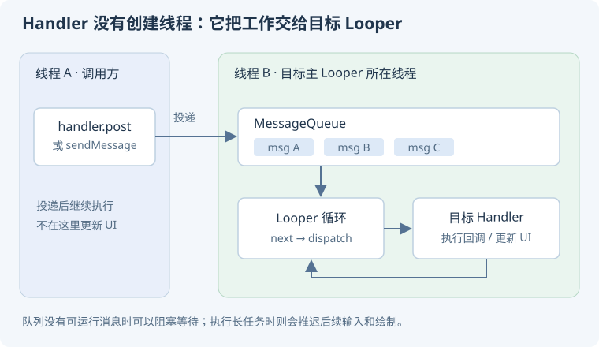

# 03 · Handler、Binder 与系统启动

Android 系统机制可以先抓住两条线：**一个进程内部如何安排工作，多个进程之间如何协作**。Handler 解决前者的一部分，Binder 支撑后者的重要路径。

## Handler 消息机制

### Handler、Looper、MessageQueue 各负责什么？ {#handler}

**Handler 是投递与处理入口，MessageQueue 管理待处理消息，Looper 在所属线程循环取出并分发消息。** 同一线程的多个 Handler 可以共用同一个 Looper；Handler 本身不创建线程。

<p class="diagram-scroll-hint">手机上可左右滑动查看完整图解。</p>

<div class="mobile-illustration">



</div>

<KnowledgeFlow title="一条消息如何回到目标线程？" :steps="[
  { title: '投递', detail: '任意线程通过 Handler 发送 Message / Runnable' },
  { title: '等待', detail: '消息进入目标 Looper 的 MessageQueue' },
  { title: '分发', detail: 'Looper 取出可执行消息并调用目标 Handler' },
  { title: '执行', detail: '回调在 Looper 所属线程运行' }
]" />

```kotlin
val mainHandler = Handler(Looper.getMainLooper())
mainHandler.post { /* 在主 Looper 线程更新界面 */ }
```

明确传入 Looper，避免依赖隐式构造的线程环境。`post` 到主线程只改变执行位置，不会把耗时任务变快。[官方：Handler](https://developer.android.com/reference/android/os/Handler)、[Looper](https://developer.android.com/reference/android/os/Looper)。

### Looper 是死循环，为什么不会一直占 CPU 或触发 ANR？ {#looper-anr}

**循环等待消息与长时间执行业务是两回事。** 没有可执行消息时，底层可以阻塞等待事件，线程不是持续忙轮询；有消息时才处理对应回调。

ANR 检测关心输入、组件等规定工作能否及时完成。某个回调执行重计算、等待锁或同步 Binder 调用，导致主线程迟迟不能处理输入，才是常见根因。不能用“循环还在运行”证明响应正常。

**追问：trace 顶部看到 `nativePollOnce` 就能认定根因吗？** 不能。采样时线程可能已经空闲，需要结合 ANR 类型、时间窗口、其他线程和系统调度现场分析。[官方：ANR](https://developer.android.com/topic/performance/issues/anr)。

### `postDelayed` 能精确定时吗，消息严格 FIFO 吗？ {#delay}

不能把 `postDelayed` 当作实时定时器。延迟时间决定消息最早具备执行条件的时间，前面回调耗时、系统调度、睡眠等都可能让它更晚执行；相关时间基准与墙上时钟也不是一回事。

MessageQueue 不能简化为无条件 FIFO：时间、队首插入、同步屏障和异步消息都会影响可运行顺序。也不能从一次观察推导跨线程投递的固定先后关系。

**场景追问：倒计时怎么做？** 记录适当时间基准上的截止时间，每次刷新重新计算剩余量，避免每秒简单减一而积累误差。[官方：Handler 定时语义](https://developer.android.com/reference/android/os/Handler)。

### 同步屏障与异步消息是什么，和异步线程一样吗？ {#barrier}

同步屏障可暂时阻挡普通同步消息，让异步消息越过等待；“异步”在这里是**队列调度属性**，不代表回调换到后台线程。

UI 调度会使用相关机制协调渲染工作，但屏障不是让所有绘制都即时执行的万能优先级。业务代码通常不应依赖隐藏 API 手动操纵屏障；错误使用或不移除屏障可能让消息长期得不到执行。

**追问：`Handler.createAsync(mainLooper)` 上的回调在哪运行？** 仍在主 Looper 线程，只是不受某些同步屏障约束。[官方：异步 Handler](https://developer.android.com/reference/android/os/Handler#createAsync(android.os.Looper))。

### Handler 泄漏与 HandlerThread 退出怎么处理？ {#handler-leak}

典型泄漏链是“活着的线程/消息队列 → 延迟消息 → Runnable 或 Handler → Activity”。内部类、lambda 捕获和长延迟都可能延长页面寿命。

优先让任务绑定生命周期，离开时取消；必须使用 Handler 时，按任务移除回调或使用 token 管理。弱引用不能代替任务停止、监听解绑和资源释放。

HandlerThread 是带 Looper 的工作线程，适合需要串行消息处理的特定 API；不用后要结束。`quitSafely` 尝试处理已到期消息并退出，不是保证未来延迟任务全部执行。[官方：HandlerThread](https://developer.android.com/reference/android/os/HandlerThread)。

## Binder 与跨进程通信

### Binder 解决什么，为什么不能说“永远只复制一次”？ {#binder}

**Binder 是 Android 关键的跨进程调用基础设施。** 调用方通过代理打包参数，驱动协助把事务交给目标进程，再由服务端分发；它还带有调用身份与死亡通知等能力。

<KnowledgeFlow title="一次同步 Binder 调用的逻辑路径" :steps="[
  { title: '客户端代理', detail: '把接口调用转换为事务与参数' },
  { title: 'Binder 驱动', detail: '查找目标、传递事务及调用身份' },
  { title: '服务端 Stub', detail: '解包参数，在相应线程执行实现' },
  { title: '返回结果', detail: '同步调用方等待结果或错误' }
]" caption="这是跨进程逻辑图；同进程接口可能直接调用，内存复制次数也取决于数据和路径。" />

传统描述常把 Binder 的映射缓冲与普通复制路径比较，但不能据此声称任意数据、任意调用都只复制一次。对象序列化、用户态拷贝、大数据传输方案也有成本。[官方：Binder 概览](https://source.android.com/docs/core/architecture/ipc/binder-overview)。

### AIDL、Messenger 和 `oneway` 怎么理解？ {#aidl}

AIDL 根据接口定义生成代理与 Stub，适用于需要明确接口的进程间通信。远程调用可能在 Binder 线程池并发进入，服务实现必须考虑线程安全；Messenger 基于消息提供另一种串行处理入口。

`oneway` 对远程事务表达调用方不等待服务端执行结果，**不意味着业务一定成功，也不等于服务端开了一个新线程**。同进程本地调用的行为也不能照搬跨进程假设。

**追问：主线程调用 AIDL 安全吗？** 同步远程方法的耗时受对端影响，即使参数很小也可能阻塞；应把线程、超时、取消和失败语义设计进接口。[官方：AIDL](https://developer.android.com/develop/background-work/services/aidl)。

### 为什么不能用 Intent 或 Binder 直接传一张大图？ {#binder-limit}

事务缓冲有限，并且由进程中的在途事务共享；“每次都能传固定大小”是不可靠的承诺。大 Bitmap 或巨型 Bundle 可能导致 `TransactionTooLargeException`。

优先传资源 ID、URI、文件描述符或受控共享内存的引用，让接收方按需读取，并明确授权与关闭责任。`Parcelable` 更适合 Android 的结构化传输场景，但仍需序列化，并不是零成本或自动支持任意版本兼容。[官方：事务过大异常](https://developer.android.com/reference/android/os/TransactionTooLargeException)。

**追问：服务端死亡怎么办？** 处理断连、`RemoteException` 和必要的死亡监听；重连与重试要避免把已经执行的业务重复提交。跨进程不能把“抛异常”简单解释成“服务端一定没执行”。

## 启动与窗口

### 点击桌面图标到 Activity 显示，大致经过什么？ {#app-start}

冷启动的概念链通常包括：Launcher 发起启动请求，系统任务/Activity 管理协调目标组件；必要时由 Zygote 派生应用进程；应用运行时与主线程建立，创建应用及页面，完成首帧渲染。

<KnowledgeFlow title="冷启动的抽象链路" :steps="[
  { title: '启动请求', detail: 'Launcher → 系统的 Activity / 任务管理' },
  { title: '创建进程', detail: '必要时由 Zygote 派生并建立运行时' },
  { title: '应用初始化', detail: '进程入口、Provider、Application 和 Activity 等阶段' },
  { title: '首帧显示', detail: '创建窗口、布局、绘制与系统合成' }
]" caption="不同 Android 版本内部类名与调用链会变化；不能把本图作为唯一源码时序。" />

**追问：Application.onCreate 是最早的业务初始化点吗？** 不一定，Provider 等初始化可能先发生。优化时应测量整条关键路径，不能只给 `onCreate` 打点。[官方：启动分析](https://developer.android.com/topic/performance/appstartup/analysis-optimization)。

### AMS / ATMS、WMS、SurfaceFlinger 各做什么？ {#system-services}

| 角色 | 理解重点 | 不应混淆 |
| --- | --- | --- |
| Activity / 任务管理相关服务 | 组件调度、任务栈、进程协调 | 不直接替业务绘制每个按钮 |
| WindowManager 系统 | 窗口布局、层次、焦点等管理 | View 树内的布局不全由它完成 |
| SurfaceFlinger | 接收图形缓冲并协调合成显示 | 不等于应用主线程的 Canvas 绘制 |

这些服务通过 IPC 和图形管线协作，业务只看到 Activity API 的简单调用。讲到源码时，先说明系统版本，再展开具体类与方法。[官方：Android 图形架构](https://source.android.com/docs/core/graphics)。

## 面试前自测

用一张纸画出 Handler 与 Binder 的差别，标明线程和进程边界。随后解释：主线程 `post` 一个网络请求、同步调用远程服务、把大图放进 Bundle，分别有什么风险？

### 自测参考答案

```text
应用进程 A
  提交线程 → Handler.enqueue → MessageQueue → Looper 所在线程执行回调

跨进程 Binder 调用
  进程 A 调用线程 → Binder 驱动 → 进程 B Binder 工作线程 → 服务方法
       同步调用通常等待结果 ←───────────────────────────┘
```

Handler 负责把工作投递到关联 Looper 的队列，调用者和执行者可以在同一线程，也可以在同一进程的不同线程。Binder 提供跨进程调用；服务端若还要更新 UI，需要继续切到自己的主线程。同进程 Binder 本地接口可能直接在调用线程执行，不能套用远程线程池模型。

| 操作 | 风险与修正 |
| --- | --- |
| `Handler(mainLooper).post { 同步网络请求 }` | 回调仍在主线程，可能触发主线程网络异常或阻塞 UI。应使用异步网络接口或合适的后台执行方式，只把渲染结果交回主线程。 |
| 主线程同步调用远程服务 | 等待远端计算、锁、I/O 或线程池，可能卡顿或 ANR；远端还可能重入回调。移出主线程，避免持锁 IPC，并定义超时、取消和失败语义。 |
| 把大图放进 Bundle 跨进程传递 | 有序列化和内存成本，并可能超过共享的事务缓冲限制。传受控 URI、文件描述符或资源 ID，接收方按需读取；不要把某个大小当成每笔事务的安全额度。 |

**验证方法：** 日志标明 PID、线程名、调用起止时间；让远程服务在测试环境延迟响应，观察调用线程等待。网络和大图分别按[消息调度](#handler)、[AIDL](#aidl)与[Binder 数据边界](#binder-limit)核对。
