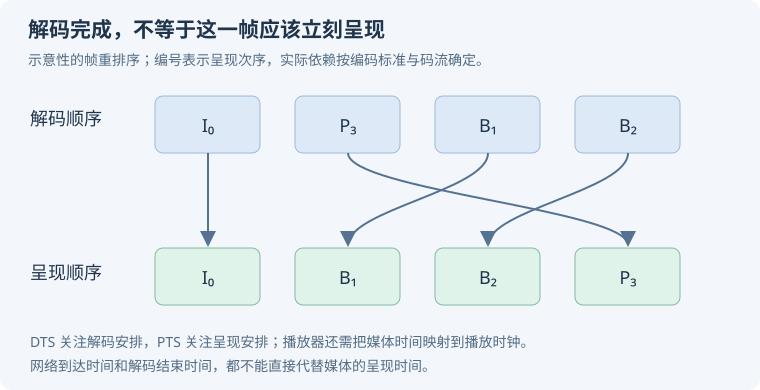

# 24 · 音视频与相机

音视频面试先把**内容格式、时间、缓冲和资源所有权**讲清楚。播放失败、首播慢、音画不同步和相机卡住，往往发生在不同层。

## 格式、压缩与时间

### 采样率、位深、声道和码率分别决定什么？ {#audio-basics}

采样率是每秒采样次数，位深描述相应样本精度，声道数描述并行音频通道。未压缩 PCM 的粗略数据率可按 `采样率 × 位深 × 声道数` 计算，例如 44.1kHz、16bit、双声道约 1.4112Mb/s。

压缩后的码率还取决于编码器与内容，不能把文件大小除以时长得到的结果当作音质的唯一评价。采样格式、端序和设备能力也需匹配。[官方：AudioFormat](https://developer.android.com/reference/android/media/AudioFormat)。

### MP4、H.264、AAC、HLS 分别属于哪一层？ {#container-codec}

MP4 是封装格式，组织音视频轨道与元信息；H.264 和 AAC 分别是常见视频、音频编码；HLS 是媒体分发/播放方案，通常通过清单组织分段与不同变体。它们不是同一维度的替代品。

```text
网络分发 / 清单 → 媒体分段或文件 → 解封装音视频轨道 → 解码 → 呈现
```

扩展名相同不保证内部编码、profile、分辨率或 DRM 都受设备支持。播放错误要先定位解封装、解码还是授权阶段。[官方：支持的媒体格式](https://developer.android.com/media/platform/supported-formats)。

### I/P/B 帧、GOP 与关键帧怎样影响压缩和 seek？ {#gop}

常见帧间编码利用前后参考降低冗余，GOP 组织一组相关帧。跳转时常需从可用随机访问点开始解码，再丢弃到目标时间附近，而不是直接解码任意位置的一帧。

较长依赖链可能提高某些压缩收益，却影响随机访问与错误恢复。不要把所有 I 帧都无条件视为相同随机访问点；IDR 等概念还依编码标准和码流而定。[官方：MediaExtractor seek 与采样](https://developer.android.com/reference/android/media/MediaExtractor)。

### PTS、DTS 与音画同步为什么不能只看系统当前时间？ {#timestamps}

PTS 描述呈现时间，DTS 描述解码时间；存在重排序时二者可能不同。播放器根据媒体时间与播放时钟安排输出，还要处理缓冲、播放速度、跳转和暂停等状态。

若把网络到达时间直接当呈现时间，抖动会传到画面；若解码完成就立刻展示，也可能破坏同步。应根据实际时钟策略区分音频漂移、视频迟到和时间戳异常，不能断言所有播放器永远用同一主时钟。[官方：MediaSync](https://developer.android.com/reference/android/media/MediaSync)。

<p class="diagram-scroll-hint">手机上可左右滑动查看完整图解。</p>

<div class="mobile-illustration">



</div>

## 编解码与播放管线

### MediaCodec 的输入、输出、flush 与 EOS 怎么理解？ {#codec}

MediaCodec 围绕状态与缓冲协议工作：输入压缩数据或相应源，取得输出并处理，再归还缓冲；EOS 表示相应流结束。同步 dequeue 和异步 callback 模式有不同调用约定。

<KnowledgeFlow title="解码资源的责任链" :steps="[
  { title: '取媒体样本', detail: '解封装得到轨道、样本与时间信息' },
  { title: '送入解码器', detail: '遵守状态机和输入缓冲约定' },
  { title: '处理输出', detail: '按时间呈现或读取数据，并释放输出' },
  { title: '结束 / 重建', detail: '处理 EOS、跳转、Surface 和 codec 生命周期' }
]" />

flush、stop 与 release 不是同义词，调用顺序错误会导致状态异常。跳转、Surface 销毁和错误恢复都要检查旧缓冲是否仍被使用。[官方：MediaCodec](https://developer.android.com/reference/android/media/MediaCodec)。

### Surface 输出是不是保证全链路零拷贝？ {#surface-output}

Surface 路径可让视频输出直接进入适当图形管线，避免应用把每帧取成 Bitmap 再上传等昂贵路径，但不能推广为所有设备、格式、合成和转换都完全不复制。

硬件解码能力、色彩转换、缩放、合成与后处理仍有成本。性能观测要区分解码、CPU 处理、GPU 与显示同步；频繁截图或逐帧回读可能破坏原本高效的路径。[官方：SurfaceView 图形路径](https://source.android.com/docs/core/graphics/arch-sv-glsv)。

### Media3 的 READY、playWhenReady 与 isPlaying 为什么不是一个状态？ {#player-state}

READY 表示播放器已具备相应播放准备条件，playWhenReady 表达播放意图，isPlaying 还综合当前状态与抑制原因等。准备好了但用户暂停、被焦点等因素抑制时，不能仅靠 READY 判断正在播放。

UI 应根据事件和明确状态更新按钮、加载与错误提示，并区分首播缓冲和播放中重缓冲。监听与播放器本身需要按所有权释放，避免列表复用后旧回调写入新行。[官方：播放器事件](https://developer.android.com/media/media3/exoplayer/listening-to-player-events)。

### HLS/DASH 自适应码率为什么不能只选“最近测速最高档”？ {#adaptive-streaming}

选择要综合可用变体、带宽估计、缓冲、设备解码能力与切换策略。过度追求高码率可能在网络抖动时频繁缓冲；只保守选低档又牺牲质量。

清单、分段、关键帧与时间对齐还影响切换和 seek。首播时间、卡顿率、清晰度和流量是共同取舍，不能只报告平均下载速度。[官方：HLS](https://developer.android.com/media/media3/exoplayer/hls)、[DASH](https://developer.android.com/media/media3/exoplayer/dash)。

### 媒体缓存和 DRM 许可为什么要分开管理？ {#cache-drm}

媒体字节已缓存，不代表仍具备播放许可。DRM 还涉及密钥会话、许可证有效期、设备能力与离线授权等；用户注销或内容撤权时需要按业务清理或隔离相应状态。

预加载也需要字节、时间和并发预算，尤其不能在视频列表里无限准备多个播放器。缓存 key 需对应正确内容版本与身份边界，日志中避免泄露授权信息。[官方：Media3 DRM](https://developer.android.com/media/media3/exoplayer/drm)。

## 音频焦点与相机

### 音频焦点丢失、duck 与暂停恢复怎样设计？ {#audio-focus}

音频焦点协调应用间的播放体验，不同丢失类型与平台行为可能要求暂停、降低音量或按规则恢复。它与播放器“是否有音频数据”不是同一个状态。

恢复还需确认用户的最新意图：用户已经手动暂停后，不能只因为焦点回来就自动播放。后台播放、耳机断开与服务/会话生命周期也需按平台规则处理。[官方：音频焦点](https://developer.android.com/media/optimize/audio-focus)。

### CameraX 分析器跟不上帧率，为什么会卡预览？ {#camera-backpressure}

分析管线需要背压策略：保留最新帧可避免旧帧积压，阻塞生产者则有不同的吞吐和延迟影响；选择取决于“每帧必须处理”还是“最新结果优先”。

ImageProxy 处理后应按约定关闭，否则缓冲无法及时回收。图像分析可在合适执行器进行，但还要限制模型推理并发，避免分析线程与预览争抢资源。[官方：CameraX 图像分析](https://developer.android.com/media/camera/camerax/analyze)。

### YUV_420_888 为什么不能简单当作连续 NV21 字节数组？ {#yuv}

图像通过多个 plane 暴露，rowStride、pixelStride 与缓冲布局需要按 API 读取；不能假定所有设备都是同一紧密排列。错误拼接常导致色偏、条纹或越界。

旋转、前置镜像、裁剪和预览缩放还会影响坐标映射。检测框从模型输入映射回屏幕，需要完整变换，而不只是把 x/y 乘一个比例。[官方：Image.Plane](https://developer.android.com/reference/android/media/Image.Plane)、[CameraX 变换](https://developer.android.com/media/camera/camerax/transform-output)。

## 排障练习

依次模拟：音频持续但视频冻结、READY 却不播放、许可过期但缓存命中、分析器忘记 close、检测框镜像错误。为每个问题标出负责层、观测数据和释放责任。
