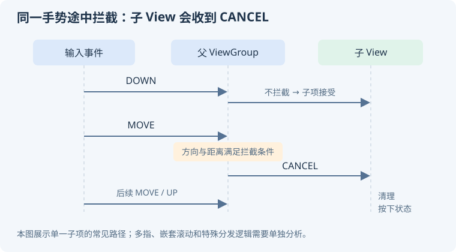

# 04 · View、事件分发与渲染

可以用两个方向记住 View 系统：**输入沿层级寻找处理者，布局把约束传给孩子并确定几何位置。** 最后由绘制与图形管线把结果呈现出来。

## 测量、布局与绘制

### `measure`、`layout`、`draw` 各做什么？ {#view-pipeline}

`measure` 确定测量尺寸，`layout` 确定 View 的位置与实际边界，`draw` 绘制自身及后代内容。父容器参与约束和安排子 View，子 View 不能无条件决定任意大小。

<KnowledgeFlow title="View 树如何变成绘制内容？" :steps="[
  { title: 'Measure', detail: '根据父约束、布局参数和自身需求计算尺寸' },
  { title: 'Layout', detail: '确定 left、top、right、bottom 等边界' },
  { title: 'Draw', detail: '绘制背景、内容、子元素等，进入渲染管线' }
]" caption="View 树可能经历多次测量；一次布局流程不保证每个节点只测量一次。" />

**追问：为什么刚构造 View 时宽高为 0？** 构造不代表已经测量或布局。依赖尺寸的逻辑应放在适当的布局回调、`onSizeChanged` 等位置。[官方：自定义绘制与尺寸](https://developer.android.com/develop/ui/views/layout/custom-views/custom-drawing)。

### MeasureSpec 的三种模式是什么？ {#measure-spec}

| 模式 | 含义 | 直觉例子 |
| --- | --- | --- |
| `EXACTLY` | 父级要求确定尺寸 | 可用空间已明确的匹配父容器 |
| `AT_MOST` | 不超过给定上限 | 在父约束内按内容决定大小 |
| `UNSPECIFIED` | 这一轮没有给出尺寸上限 | 某些滚动或特殊测量场景 |

**不能机械背“match_parent 永远 EXACTLY、wrap_content 永远 AT_MOST”。** 子 MeasureSpec 由父约束、padding、布局参数和父容器算法一起决定。

自定义 View 需要处理期望尺寸、padding、最小尺寸和父约束，常用 `resolveSizeAndState` 等工具完成约束解析。[官方：View](https://developer.android.com/reference/android/view/View)。

### `invalidate` 与 `requestLayout` 有什么区别？ {#invalidate}

**显示内容变化通常请求重绘；尺寸或布局需求变化通常请求重新布局。** `invalidate` 使相关绘制内容失效，不保证立即执行 `onDraw`；`requestLayout` 请求布局过程，可能触发测量和后续绘制。

改变进度条颜色通常不必重走完整布局；改变影响固有尺寸的文本、padding 等则可能需要布局。重复、无意义地调用 `requestLayout`，会增加主线程工作。

**追问：用了 `postInvalidate` 就能在后台随便修改 View 吗？** 不能。它提供请求重绘的线程便利，不代表 View 的所有属性和内部状态都变得线程安全。[官方：View 更新 API](https://developer.android.com/reference/android/view/View)。

### 自定义 View 时如何避免绘制卡顿？ {#custom-view}

先算清尺寸与几何关系，再把频繁绘制路径做轻。Paint、Path 等可复用对象尽量避免每帧重复创建；昂贵计算或大图解码移出绘制回调。缓存也要在尺寸、数据和主题变化时正确失效。

**不要把“少用一层布局”当成所有卡顿的结论。** 还要检查像素填充、过度绘制、复杂阴影、图片上传和 GPU 工作。硬件加速也不是所有操作都零成本。

可先用简单几何图形替代复杂内容做对照实验，再结合 trace 判断是否是绘制瓶颈。[官方：自定义绘制](https://developer.android.com/develop/ui/views/layout/custom-views/custom-drawing)。

## 触摸事件与滚动

### `dispatchTouchEvent`、`onInterceptTouchEvent`、`onTouchEvent` 怎么配合？ {#touch-dispatch}

`dispatchTouchEvent` 是分发入口；ViewGroup 可在 `onInterceptTouchEvent` 决定是否截获；最终处理者通过 `onTouchEvent` 等路径消费事件。`DOWN` 对后续手势目标的建立很重要。

手机上可左右滑动查看完整图解。

<KnowledgeFlow title="父容器在滑动途中拦截的典型结果" :steps="[
  { title: 'DOWN 分发', detail: '命中的子 View 接受本次手势' },
  { title: 'MOVE 判断', detail: '父容器根据方向和距离决定拦截' },
  { title: '子项 CANCEL', detail: '子 View 结束当前手势并清理按下状态' },
  { title: '父级处理', detail: '后续事件交给父容器处理' }
]" />

**追问：为什么点按有效、移动后按钮卡在按下态？** 检查是否正确处理 `ACTION_CANCEL`，不要只在 `UP` 清理状态。多指还要跟踪 pointer ID，而不是把 pointer index 当作稳定身份。[官方：ViewGroup 触摸处理](https://developer.android.com/develop/ui/views/touch-and-input/gestures/viewgroup)。

### 横向列表嵌套纵向滚动，滑动冲突怎么处理？ {#scroll-conflict}

先确认谁该在什么条件下消费，再选择方向判断、`requestDisallowInterceptTouchEvent` 或嵌套滚动协议。通常在超过 touch slop 后比较位移方向，避免微小抖动抢走点击。

嵌套滚动允许父子协商预消费、已消费和剩余距离，并支持 fling 等过程；它与“触摸事件拦截”不是同一层机制。

**易错点：** 不要在 `DOWN` 就无条件让父级永不拦截，也不要把所有事件都返回 true。列表到边界时谁接手、多指切换、取消和快速甩动，都要验证。[官方：手势与滚动](https://developer.android.com/develop/ui/views/touch-and-input/gestures/viewgroup)。

## 列表与帧调度

### RecyclerView 如何复用，为什么会图片错位？ {#recyclerview}

RecyclerView 协调布局、ViewHolder 复用与数据更新，不等于“每项永远只创建一次”。缓存层和复用池细节随版本变化，重点是把复用与绑定分开理解。

**绑定应完整表达当前数据状态。** 文本、勾选、可见性等都要重置；图片异步返回时必须与当前目标绑定关系一致，并取消或替换旧请求，否则旧结果会写进被复用的行。

点击时还要考虑位置已变化或 `NO_POSITION`，尽量围绕稳定业务 ID 处理操作。[官方：RecyclerView](https://developer.android.com/develop/ui/views/layout/recyclerview)。

### DiffUtil 的“同一项”和“内容相同”怎么区分？ {#diffutil}

`areItemsTheSame` 判断是不是同一业务实体，通常比较稳定 ID；`areContentsTheSame` 判断这项展示内容是否变化。两者的职责不能互换。

`ListAdapter` / `AsyncListDiffer` 可在适当线程计算差异，但输入列表和参与比较的元素在计算期间应保持稳定。**不要原地修改同一份列表，再希望差异算法识别旧状态。** payload 可以表达局部变化，完整绑定仍需兜底。

**追问：stable IDs 就等于 DiffUtil 吗？** 不是。它们参与的身份与更新机制不同，也都不能修复错误的数据建模。[官方：DiffUtil](https://developer.android.com/reference/androidx/recyclerview/widget/DiffUtil)。

### Choreographer、VSync 与掉帧是什么关系？ {#vsync}

VSync 帮助协调显示节奏，Choreographer 组织与帧相关的回调；应用侧准备绘制内容后，还需渲染、缓冲和系统合成。并非“主线程 `onDraw` 返回就立刻显示”。

| 刷新率 | 每个刷新周期的大致时长 |
| --- | --- |
| 60 Hz | 16.67 ms |
| 90 Hz | 11.11 ms |
| 120 Hz | 8.33 ms |

这些是周期长度，不能全部当成某一个函数独占的预算。高刷、流水线、系统调度和 GPU 都影响 deadline；要结合 Frame Timeline / trace 分析是哪一段没赶上。[官方：渲染性能](https://developer.android.com/topic/performance/issues/render)。

### View 动画和属性动画有什么区别？ {#animation}

传统补间动画主要作用于显示变换，不等于改变布局参数；属性动画更新对象属性，如 alpha、translationX，也可驱动自定义属性。**改变 translationX 通常不意味着重新布局，也不能把它等同于修改 left/right。**

动画性能取决于触发了什么工作：每帧修改布局参数可能引起布局；可被图形管线高效处理的变换通常更合适。大范围透明度、复杂层与过度绘制也可能昂贵。

**追问：页面结束后动画要处理什么？** 停止不再需要的回调，避免持有旧 View；同时尊重系统的动画和无障碍偏好。[官方：属性动画](https://developer.android.com/develop/ui/views/animations/prop-animation)。

## 面试前自测

录下一个真实触摸序列，打印 `DOWN/MOVE/CANCEL/UP`；再做一个复用列表，故意延迟图片返回，解释错位为什么发生。最后分别触发只重绘和需要重布局的更新，用工具观察差别。

### 自测参考答案

1. **触摸序列：** 在父容器与子 View 的分发、拦截、消费处分别记录事件。若子 View 消费了 DOWN，后续父容器在 MOVE 决定拦截，子 View 会收到 CANCEL，此后不能再期待它收到本次手势的 UP。CANCEL 与 UP 都要清理按下态、拖动状态和长按回调，但 CANCEL 不应触发点击提交；日志里 MOVE 的数量由真实输入决定。
2. **图片错位：** ViewHolder 先绑定 A 并发起慢请求，复用后绑定 B，A 的旧回调仍写入同一个 ImageView。绑定新项时重置占位和旧状态、取消旧请求；回调再校验当前请求 token 或业务 ID，过期则丢弃。取消存在竞态，稳定 ID 和 DiffUtil 本身也不会替异步回调做身份校验。
3. **绘制与布局：** 自定义 View 改变不影响尺寸的画笔颜色后调用 `invalidate()`，通常只需重新绘制；改变参与尺寸计算的内容后调用 `requestLayout()`，需要重新测量或布局，必要时同时请求重绘。一次帧内多次请求可能合并，父子约束也会影响遍历范围，不能只按 API 调用次数估算开销。

**验证方法：** 在自定义 View 的 `onMeasure/onLayout/onDraw` 打点，保持其他状态不变进行两组更新；图片实验让 A 慢、B 快并快速滚动，确认 B 不再被 A 覆盖。结合帧 trace 检查实际工作量。原理见[事件分发](#touch-dispatch)、[列表复用](#recyclerview)与[刷新方式](#invalidate)。
